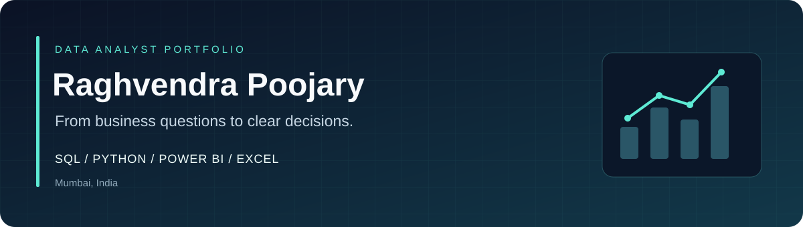

  

  
  

<b>SQL analysis &nbsp;·&nbsp; Data validation &nbsp;·&nbsp; Statistical exploration &nbsp;·&nbsp; Business dashboards</b>

## Hello, I'm Raghvendra

A BCA graduate based in **Mumbai**, building a career in **Data**. I enjoy working through business questions, checking the data behind the numbers, and presenting findings that help business make informed decisions.

My portfolio brings together **SQL, Python, Power BI, and Excel**, with a focus on cleaning and exploring data, identify patterns, and communicate findings through clear dashboards and practical recommendations.

As an aspiring Data Analyst pursuing data science, I’m also exploring how generative AI can support analytical workflows—from developing questions and refining code to communicating insights. My approach is to check AI-assisted work against the data and apply critical thinking before drawing conclusions.

## My toolkit

  
  
  
  
  
  
  

| Query & validate | Analyse & explain | Visualise & communicate |
| :--- | :--- | :--- |
| Joins, CTEs, window functions | Exploratory and statistical analysis | Power BI and Excel dashboards |
| Data-quality checks and KPI reconciliation | Customer segmentation and performance trends | Business requirements and recommendations |

## Featured case study

### [Finance Analytics & Transaction Risk Monitoring](https://github.com/raghvendra-poojary/Finance-Analytics-Transaction-Risk-Monitoring)

**How can a financial-services team monitor transaction reliability, customer activity, and risk-review workload?**

A portfolio case study connecting business requirements, SQL Server validation, Python analysis, and Power BI reporting.

| Analysis scope | Data preparation | Reporting |
| :--- | :--- | :--- |
| **50,000** cleaned transactions | **69** duplicate rows removed | **2** Power BI report pages |
| **5,000** customer records | SQL validation and KPI checks | Findings and business recommendations |

**What you'll find:** transaction-success analysis, customer activity segments, risk-threshold comparisons, a Python notebook, dashboard previews, and documented recommendations.

*Uses synthetic educational data. Recommendations are proposed; implemented business outcomes are not claimed.*

**[Explore the case study →](https://github.com/raghvendra-poojary/Finance-Analytics-Transaction-Risk-Monitoring)**

## More projects

| Project | Focus | Tools |
| :--- | :--- | :--- |
| **[Sales & Customer Analysis](https://github.com/raghvendra-poojary/sql-eda-project)** | Revenue contribution, product rankings, customer segmentation, and performance comparisons | MySQL · CTEs · Window functions |
| **[Online Bookshelf](https://github.com/raghvendra-poojary/online-bookshelf)** | MERN application with Stripe payments; additional software-development experience | MongoDB · Express · React · Node.js |

## How I approach analysis

**Business question → Data exploration → Validation → Analysis → Dashboard → Recommendations**

I aim to make each project easy to inspect: explain the question, define the metrics, show the work, and document assumptions and limitations.

---

  <b>Interested in entry-level Data Analyst, BI Analyst, and Reporting Analyst opportunities.</b>  
  <a href="https://www.linkedin.com/in/raghvendra-poojary">Let's connect on LinkedIn →</a>

